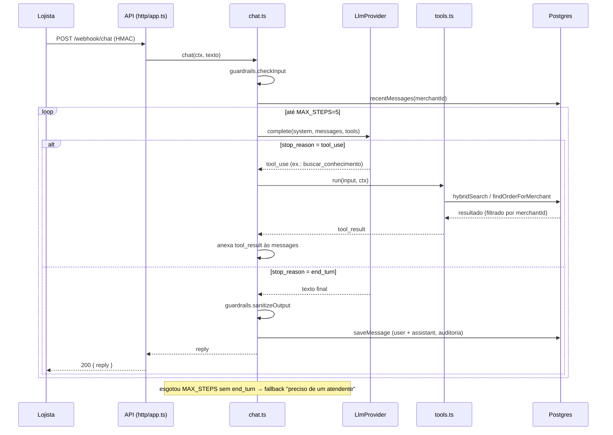

# Arquitetura do `merchant-support-lab`

Dois fluxos de dados independentes chegam ao mesmo núcleo (Postgres + Redis + Agente de LLM):

1. **Pedidos**: evento assíncrono via Kafka → grava estado no Postgres.
2. **Chat**: pergunta do lojista (webhook HTTP ou fila SQS) → agente com RAG e tools → resposta.

## Visão geral

```mermaid
flowchart LR
  subgraph EXT["Fora do sistema"]
    PROV["Sistema de pedidos\n(publica evento)"]
    LOJA["Lojista\n(WhatsApp / webhook)"]
    CANAL["Canal assíncrono\n(ex.: fila de atendimento)"]
  end

  subgraph API["API — src/server.ts"]
    HTTP["Express\nPOST /webhook/chat\nPOST /dev/orders\nGET /health/*"]
    ORD_CONS["Kafka Consumer\nsrc/kafka/orders-consumer.ts"]
  end

  subgraph WRK["Worker — src/worker.ts (processo separado)"]
    SQS_CONS["SQS Consumer\nsrc/sqs/consumer.ts"]
  end

  subgraph AGENTE["Agente — src/agent, src/llm, src/guardrails.ts"]
    GUARD["guardrails.checkInput"]
    CHAT["chat.ts\nloop de tools (max 5 steps)"]
    LLM["LlmProvider\nFakeLlm ou AnthropicLlm"]
    TOOLS["tools.ts\nbuscar_conhecimento / consultar_pedido"]
  end

  subgraph DADOS["Dados"]
    PG[("Postgres + pgvector\norders · conversations\ndocuments · chunks")]
    REDIS[("Redis\nidem:* claim/release")]
  end

  subgraph MSG["Mensageria"]
    K_TOPIC[["Kafka: lab.orders.v1"]]
    K_DLQ[["Kafka: lab.orders.v1.dlq"]]
    SQS_Q[["SQS: lab-messages"]]
    SQS_DLQ[["SQS: lab-messages-dlq\n(após maxReceiveCount=3)"]]
  end

  subgraph OBS["Observabilidade"]
    OTEL["OpenTelemetry SDK\nsrc/telemetry.ts"]
    JAEGER["Jaeger :16686"]
  end

  %% fluxo de pedidos
  PROV -->|"publish key=orderId"| K_TOPIC
  K_TOPIC --> ORD_CONS
  ORD_CONS -->|"claim/release idempotência"| REDIS
  ORD_CONS -->|"retry c/ backoff+jitter\n(src/kafka/retry.ts)"| ORD_CONS
  ORD_CONS -->|"esgotou tentativas\nou poison pill"| K_DLQ
  ORD_CONS -->|"UPSERT (idempotente)"| PG
  HTTP -.->|"/dev/orders (atalho de estudo)"| K_TOPIC

  %% fluxo de chat via HTTP
  LOJA -->|"POST assinado HMAC-SHA256"| HTTP
  HTTP --> GUARD --> CHAT

  %% fluxo de chat via fila
  CANAL --> SQS_Q --> SQS_CONS
  SQS_CONS -->|"claim idempotência"| REDIS
  SQS_CONS -->|"não deleta em erro\n→ reaparece (visibility timeout)"| SQS_Q
  SQS_CONS -->|"após maxReceiveCount"| SQS_DLQ
  SQS_CONS --> CHAT

  %% núcleo do agente
  CHAT -->|"system+messages+tools"| LLM
  LLM -->|"stop_reason=tool_use"| CHAT
  CHAT --> TOOLS
  TOOLS -->|"busca híbrida (RRF)"| PG
  TOOLS -->|"WHERE merchant_id = sessão"| PG
  CHAT -->|"histórico + auditoria"| PG

  %% observabilidade
  API -.-> OTEL
  WRK -.-> OTEL
  OTEL -.-> JAEGER
```

## Loop do agente (tool use) em detalhe

Esse é o trecho não óbvio de `src/agent/chat.ts`: o "vai e volta" entre o modelo e as tools, limitado por `MAX_STEPS`.

## Por que dois fluxos de entrada (HTTP e SQS) chamam o mesmo `chat()`

`src/http/app.ts` e `src/worker.ts` são processos diferentes (dois Deployments distintos no `k8s/deployment.yaml` seria o próximo passo), mas os dois só fazem a ponte até `agent/chat.ts` — a lógica do agente, as tools e os guardrails não sabem se a pergunta chegou por webhook ou por fila. Isso é o mesmo motivo de `LlmProvider` ser uma interface (`src/llm/provider.ts`): a borda de transporte troca, o núcleo não.
